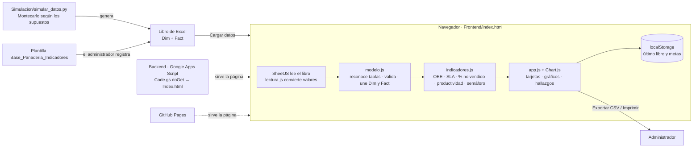
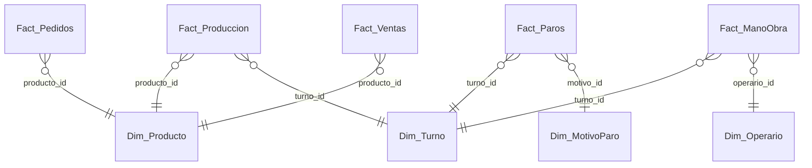

# Arquitectura de la solución

Aplicación web **de cliente puro**: todo corre en el navegador del usuario. No hay servidor de cálculo, base de datos ni cuentas. Google Apps Script solo entrega la página. La justificación de la tecnología está en [Decisiones_Tecnicas.md](Decisiones_Tecnicas.md).

## 1. Vista general

## 2. Componentes

| Carpeta / archivo | Responsabilidad | Historia |
|---|---|---|
| `Frontend/index.html`, `css/styles.css` | Módulos **Tablero** y **Cargar datos**; móvil e impresión | HU-01 (crece en cada historia) |
| `Frontend/js/app.js` | Interfaz: navegación, carga, tarjetas, metas, filtros, gráficos, hallazgos, exportación | HU-01 a HU-14 |
| `Frontend/js/lectura.js` | Convierte textos, números (coma decimal) y fechas (también número de serie de Excel) | HU-04 |
| `Frontend/js/modelo.js` | Reconoce las tablas por sus columnas, valida filas y une hechos con dimensiones | HU-05 |
| `Frontend/js/indicadores.js` | Tiempos por turno, disponibilidad, rendimiento, calidad, OEE, SLA, % no vendido, productividad, filtros, Pareto y semáforo | HU-06 a HU-12 |
| `Frontend/vendor/` | SheetJS 0.18.5 (HU-04) y Chart.js 4.4.1 (HU-12), incluidas para funcionar sin internet | HU-04, HU-12 |
| `Frontend/datos/` | Plantilla vacía, datos simulados de septiembre de 2026 y su versión para el botón de ejemplo | HU-02, HU-03 |
| `Simulacion/` | Simulación de Montecarlo (Python) y archivo de octubre para la prueba con un archivo distinto | HU-03, HU-15 |
| `Backend/` | Publicación en Google Apps Script: `Code.gs`, `appsscript.json`, `construir_index.py` y el `Index.html` generado | HU-01, HU-06, HU-16 |
| `Tests/` | Pruebas automáticas (`npm test`), un archivo por historia | HU-04 a HU-15 |

`lectura.js`, `modelo.js` e `indicadores.js` son **funciones puras sin acceso a la pantalla**: se prueban con Node.js sin abrir el navegador, y `app.js` solo las llama.

## 3. Flujo de datos

1. El administrador arrastra el libro en **Cargar datos**; SheetJS lo lee en el navegador (HU-04).
2. `Modelo.detectarTablas()` identifica cada hoja por sus columnas: producción, paros, pedidos, ventas, mano de obra, productos, turnos, motivos y operarios (HU-05).
3. `Modelo.construirModelo()` valida cada fila (las inválidas se listan con hoja, fila y motivo) y une hechos con dimensiones (HU-05).
4. `Indicadores.calcularRegistros()` arma un registro por **turno** (y por equipo, si el archivo trae varios) (HU-06):
   - tiempo programado = duración del turno − descanso − paros con `excluir_tiempo_programado = S`;
   - tiempo operativo = programado − paros no planeados;
   - tiempo ideal = Σ unidades × (tiempo de horneado ÷ unidades por tanda).
5. `Indicadores.analizar()` aplica los filtros y calcula los consolidados **sumando primero tiempos y unidades** (HU-06 a HU-12).
6. `app.js` dibuja tarjetas con el semáforo de las fichas, gráficos y hallazgos, y guarda el libro y las metas en `localStorage`.

## 4. Modelo de datos (estrella)

Detalle de campos y reglas: [Diccionario_Datos.md](Diccionario_Datos.md).

## 5. Decisiones de diseño

| Decisión | Por qué |
|---|---|
| Consolidar sumando tiempos y unidades, no promediando porcentajes | Lo exigen las fichas técnicas; un turno corto no pesa igual que uno largo |
| Reconocer las tablas por sus columnas y no por el nombre de la hoja | El archivo del docente puede tener otros nombres de hoja |
| La columna de máquina es opcional | La panadería tiene un solo horno; la base del curso trae varias máquinas y también funciona |
| % no vendido solo por día | Las ventas se registran por día; dividir ventas diarias entre la producción de un turno daría un dato falso |
| Motivo de paro fuera del catálogo no cuenta | No se sabe si es planeado; se avisa para que el usuario lo agregue a Dim_MotivoParo |
| Datos solo en el navegador | Privacidad y costo cero de servidor |
| `Index.html` de Apps Script se genera, no se edita | El código fuente es uno solo y vive en el repositorio |
